# Ora

A big clock for Tessera's screensaver, in the colours you choose. Ora (Greek for "hour") shows the hours and the
minutes in two boxes as large as the screen allows, with the date, the weather's icon and the outside temperature under
them.

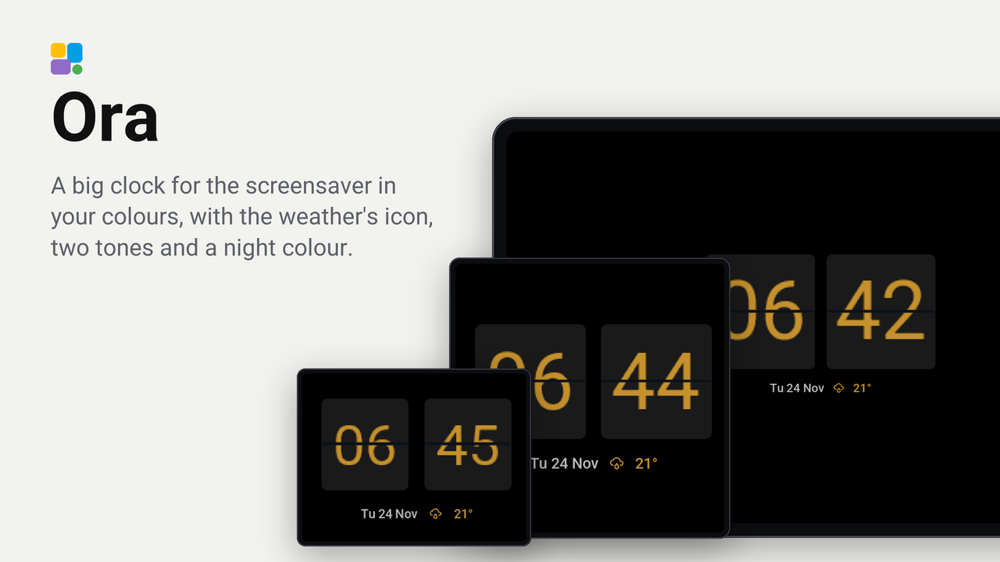

## Set up

1. In Tessera, open **Plugins**, choose **Add with a link** and paste `https://github.com/CooLaToS/tessera-plugin-ora`
   (or find **Ora** in the list once it is listed there). Add it to a screen; the screen builds once.
2. Open the screen's **Settings** and the **Screensaver** card. Turn on **Show in standby** (the screen needs
   **Auto standby** on too).
3. Click the **Clock** step and choose **Ora** under **Face**.
4. Pick the colours, the style and the size in the same drawer.
5. For the weather's icon: in the same drawer, press **+** beside the clock, add your weather entity and choose
   **Icon** under **Shows**.

## Examples

Every picture is the real firmware with Ora, drawn by Tessera's plugin bench on a Guition 4-inch (480 x 480) unless it
says otherwise. Under each one, the options that make it.

| | |
|---|---|
| 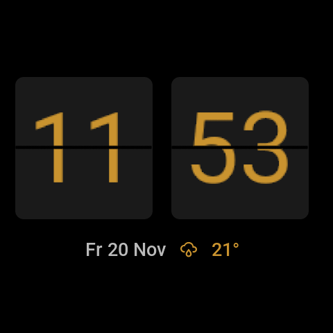 | 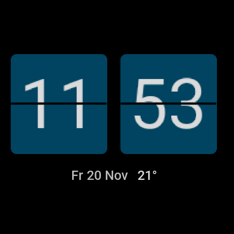 |
| **Gold flip cards**: the defaults. | **White on blue**: hours White, boxes Blue. |
| 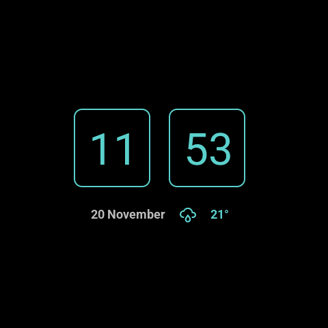 | 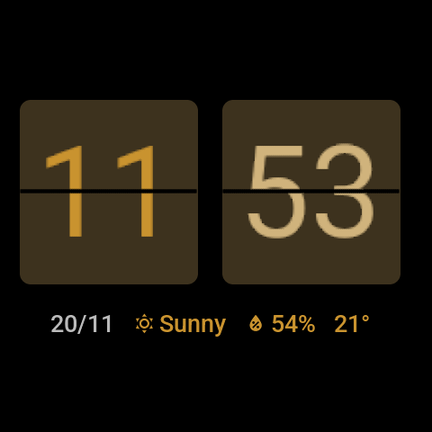 |
| **Normal size**: hours Teal, style Outline, size Normal, date 20 November. | **Two tones**: hours Gold, minutes Champagne, boxes Tinted, date 20/11, row Icons and words. |

<details>
<summary><b>Show all examples</b> (six more: wood tones, stacked, plain, a CYD and a 10-inch)</summary>

| | |
|---|---|
| 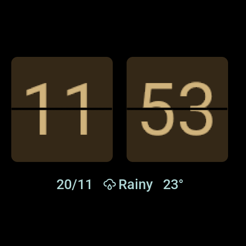 | 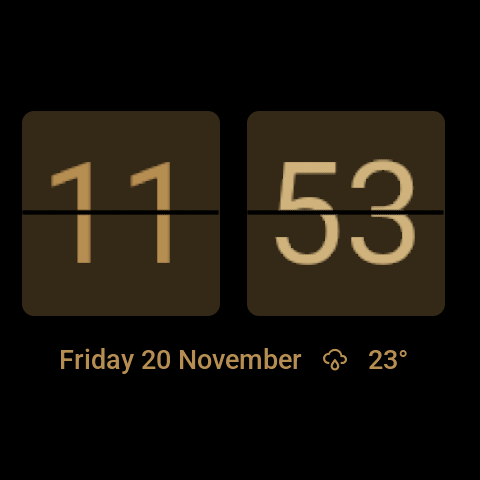 |
| **Wood**: hours Champagne, boxes Walnut, date and temperature Mint, date 20/11, row Icons and words. | **Oak and walnut**: hours Oak, minutes Champagne, boxes Walnut, date Oak, date Friday 20 November. |
| 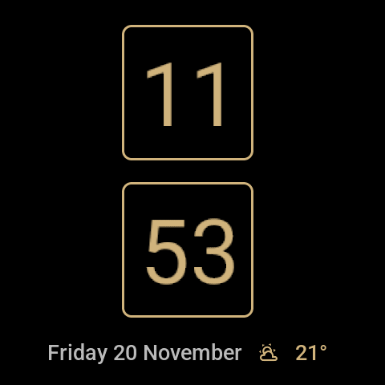 | 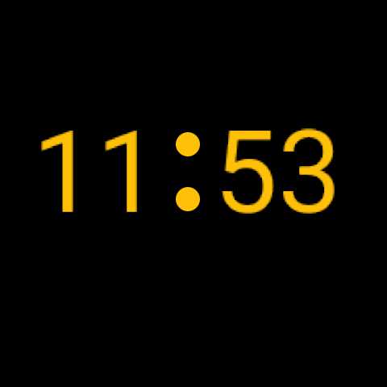 |
| **Outline, stacked**: hours Champagne, style Outline, size Stacked, date Friday 20 November. | **Plain**: hours Amber, style Plain digits, no leading zero, no seconds dot, no date, row Off. |
| 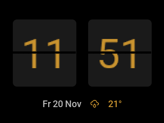 | 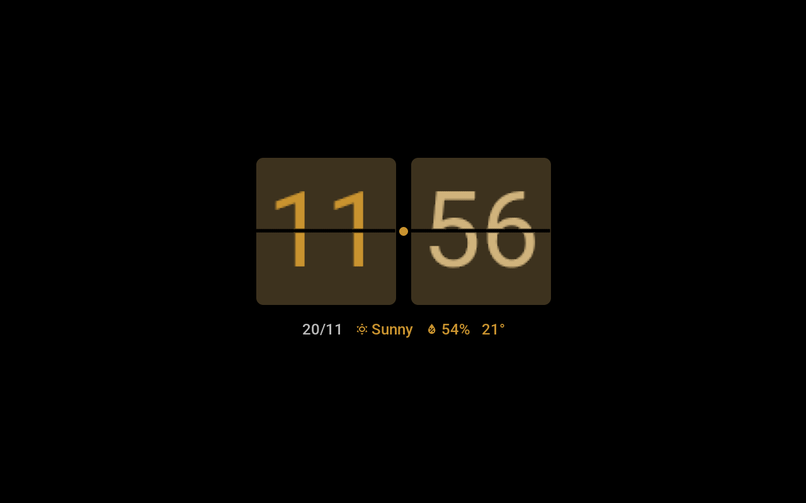 |
| **CYD 2.8-inch** (320 x 240): the defaults. | **Guition 10.1-inch** (1280 x 800): two tones. |

</details>

## Options

- **Hours colour** and **Minutes colour**: Gold (default), Champagne, Amber, Orange, Red, Pink, Purple, Blue, Teal,
  Green, Oak, Walnut, Mint, White or Night grey. Give the minutes their own colour for two tones.
- **Box colour**: Graphite flip cards, cards Tinted with the hours' colour, or any colour above. With **Outline** it is
  the colour of the line.
- **Style**: Flip cards, Outline, or Plain digits with a colon.
- **Size**: Large (side by side, as wide as the screen; best on a square or wide screen), Stacked (hours above
  minutes; best on a tall screen) or Normal (the screen's own digit size).
- **Date**: Fri 20 Nov, 20/11, 20 November, Friday 20 November, Friday, or no date.
- **Weather and entities**: the entities you add to the Clock step's row (the **+** beside the clock in the Clock
  drawer). A weather entity shows its condition, sun, cloud or rain, before the temperature. Icons (default), icons and
  words, or off. Up to four; those that do not fit the width are left out.
- **Date colour** and **Temperature colour** (also the colour of the row's icons).
- **Night colour**: during the screen's night hours the same colours, the same but dimmer, or one colour for the whole
  clock (deep red is easy on the eyes).
- **Leading zero** (09:05 or 9:05) and **Seconds dot**.

## Tried on

- **Real screens**: two Guition ESP32-S3-4848S040 (4-inch, 480 x 480) with Tessera 0.4.99 and firmware 0.62.0, one
  on a wall and one on a desk: the gold flip cards in Large, the minute changing, the seconds dot, the date and the
  temperature, in standby by day. The other styles and colours are from the bench so far.
- **The bench** of tessera-plugins (the real firmware, built for a computer): the CYD 2.8-inch, the Guition 4-inch,
  the Waveshare 4.3-inch standing up and the Guition 10.1-inch, every option.
- **The firmware build** on GitHub (`.github/workflows/build.yml`) compiles Ora into the newest Tessera release for the
  CYD (ESP32, 4 MB), the Guition 4-inch (ESP32-S3) and the Guition 10.1-inch V3 (ESP32-P4), at every change and
  every Monday.
- Every screen Tessera supports can run it (`boards: any`) once it has plugin API 0.27. Screens that never go into
  standby, such as the Waveshare 4.3-inch, show no screensaver at all, so no Ora either.
- On a large screen (7 and 10 inch) the clock stays in the middle at three times the digits' own size instead of
  filling the glass: larger, the scaled digits show their pixels.

Tried it on another screen? Tell me how it looks in a ["Tried it on my screen" issue](https://github.com/CooLaToS/tessera-plugin-ora/issues/new/choose).

## Privacy

Ora makes no connections and performs no Home Assistant actions. It draws only what Tessera's clock step hands every
face: the time, the outside temperature and the entities you put in the clock's row.

## Good to know

- Any colour on any box stays readable: when the digits would not stand out enough from their box (red on blue, say),
  Ora darkens the box until they do.
- The weather icon needs a Tessera release with the fix for
  [MaxGramser/homeassistant_espscreen#448](https://github.com/MaxGramser/homeassistant_espscreen/issues/448): up to
  Tessera 0.4.99 a plugin's clock face receives the row's icons as 0, so Ora shows the date and the temperature without
  the icon. Nothing to change in Ora: the icon appears once Tessera hands it over.
- Large and Stacked scale the screen's largest digits up (a plugin brings no font of its own), so they are a little
  softer than the font's own size.
- The night colour is chosen when the screensaver comes on. If the night hours begin while the clock is already showing,
  it changes the next time the screen goes to standby.
- The screen moves the whole clock a millimetre every minute, so nothing stands on the same pixels for hours.
- A screen without the plugin shows Tessera's own clock.
- English and Greek. The Greek texts show once Tessera itself speaks Greek: its editor and its screens' fonts do not
  have Greek yet.

## Tests

```sh
uv run tests/run.py              # unit, check and bench
uv run tests/run.py unit         # only the unit tests of the face's logic (seconds)
```

- **unit**: `components/ora/ora_logic.h` (the choices, the time and date texts, the line under the clock, where every
  part stands on every kind of screen, and the contrast of every colour on every box) compiled for your computer with
  the sanitizers, `tests/test_logic.cpp`.
- **check**: Tessera's `tools/check.py`.
- **bench**: Tessera's bench in strict mode: the showcase on four kinds of screen, then the layout combinations of
  `tests/combos.py` on the Guition 4-inch. Any finding fails. `ORA_FULL=1` renders all 486 combinations.

The check and the bench need a clone of [tessera-plugins](https://github.com/MaxGramser/tessera-plugins) beside this
repository (or `TESSERA_PLUGINS=<path>`), its bench set up once (`python3 tools/preview.py --setup` there).

On GitHub, `check.yml` runs the unit tests, Tessera's check and a secret scan, `build.yml` the firmware builds (at
every change and every Monday), `tessera-watch.yml` builds again the day a new Tessera release comes out, and
`release.yml` publishes a release from a `v*` tag only when the check and the builds pass.

## Bugs, ideas and pull requests

Found a bug, tried Ora on a new screen or have an idea? Open an
[issue](https://github.com/CooLaToS/tessera-plugin-ora/issues/new/choose); the forms ask for what is needed. Pull
requests for fixes, translations and small improvements are welcome. Read [CONTRIBUTING.md](CONTRIBUTING.md) first:
it has the rules and the checks to run.

## Credits

The layout of the flip cards follows Tessera's own Flip clock example (MIT, Max Gramser). Ora is written from
Tessera's plugin template.
